# Adventures in Artilian — Full Art Pass Gallery (Sections 2.1–2.4)

- **Branch:** `art/pass-3-pets` (built on `art/pass-2-weapons-items` → `art/pass-1-armor`)
- **Verification:** `python tools/art/lint_art.py --strict` clean across all 32 entities + 5 armors · `./gradlew build runGameTestServer` `229/229` green
- **Per-section docs:** [Section 2.2](art-pass-section-2-2.md) · [Section 2.3](art-pass-section-2-3.md)

## Contents
- [Section 2.1 — 3D Armor Sets (5)](#section-21--3d-armor-sets-5)
- [Section 2.2 — Hero Weapons & Staves (11)](#section-22--hero-weapons--staves-11)
- [Section 2.3 — Tool Sets, Boss Summons, Trophies, Materials & Utility (39)](#section-23--tool-sets-boss-summons-trophies-materials--utility-39)
- [Section 2.4 — Entities: Companion, Pets, Enemies & Bosses (32)](#section-24--entities-companion-pets-enemies--bosses-32)

---

## Section 2.1 — 3D Armor Sets (5)

All 5 GeckoLib 3D armor sets (`v3` pass) with hue-shifted shading, custom silhouettes, and `_glowmask.png` emissive accents.

| Preview | Armor Set | Tier / Phase | Palette & Silhouette Notes |
| :---: | :--- | :--- | :--- |
| 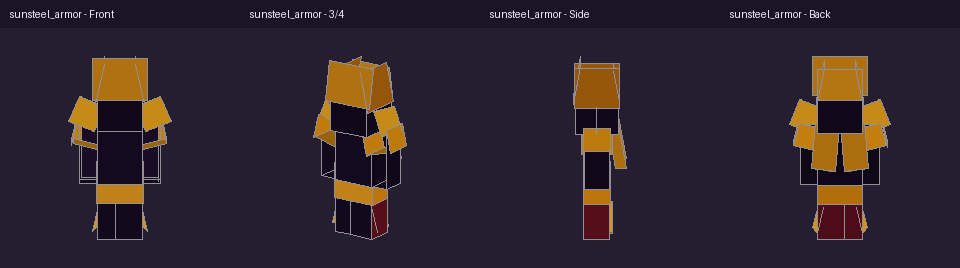 | **Sunsteel Armor** `sunsteel_armor` | Phase 1 (Starter) | Obsidian-crimson plate with hammered-gold bevels, solar crest helm, and molten-ember core accents. |
| 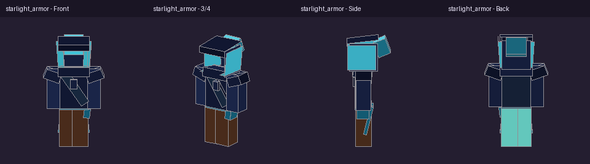 | **Starlight Armor** `starlight_armor` | Phase 1 (Starter) | Midnight-indigo steel with glowing starlight-cyan crystal trim, constellation helm crest, and teal rune accents. |
| 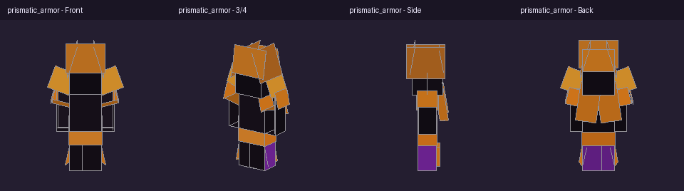 | **Prismatic Armor** `prismatic_armor` | Phase 3 (Boss-Forged) | Admiral brass-gold & cutlass-steel regalia with prism-violet inlay, magma-orange core, and pirate-admiral pauldrons. |
| 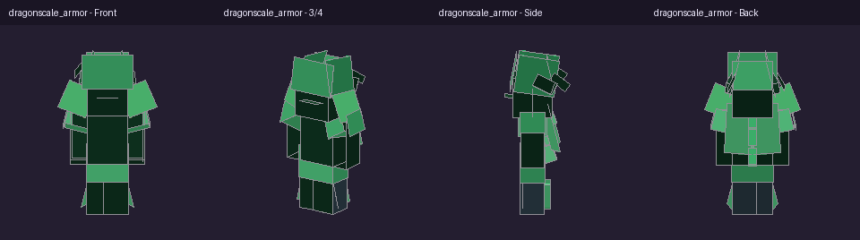 | **Dragonscale Armor** `dragonscale_armor` | Phase 5 (Dragon Jungle) | Emerald dragonscale plates with drake-bone horn crests, slate-iron backing, and glowing amber eye accents. |
| 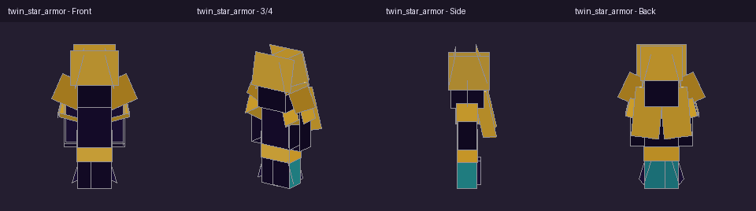 | **Twin-Star Armor** `twin_star_armor` | Phase 5 (Endgame) | Seraphic platinum-silver & void-indigo plate with winged gold/platinum pauldrons and dual cyan/amber star cores. |

---

## Section 2.2 — Hero Weapons & Staves (11)

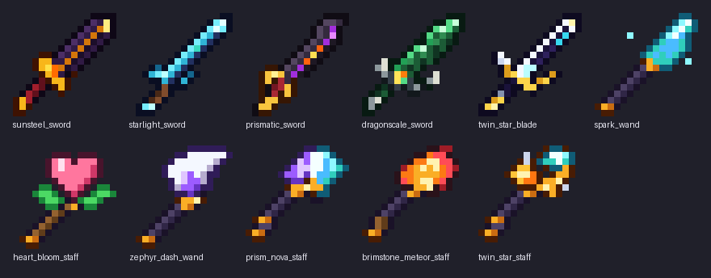

### Hero Swords & Blades (5 Items)

Each blade uses its corresponding v3 armor set's exact hue-shifted palette and a bespoke `16×16` silhouette.

| Icon (4×) | Item | Set / Tier | Tooltip | Silhouette & Palette Notes |
| :---: | :--- | :--- | :--- | :--- |
| 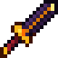 | **Sunsteel Sword** `sunsteel_sword` | Sunsteel (Phase 1) | *Sturdy Sunsteel blade* | Broad obsidian-crimson blade with hammered-gold fuller, flared sun-ray crossguard, molten solar core, crimson grip, and gold pommel. |
| 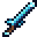 | **Starlight Sword** `starlight_sword` | Starlight (Phase 1) | *Swift Starlight blade* | Sleek midnight-indigo steel with glowing starlight-cyan crystal edge, swept crescent guard, warm leather grip, and teardrop pommel. |
| 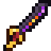 | **Prismatic Sword** `prismatic_sword` | Prismatic (Phase 3) | *Boss-forged blade — Lights up and burns foes!* | Pirate-admiral curved cutlass with gold knuckle-bow D-guard, crimson grip, and arcane-violet & magma-orange prism inlay. |
| 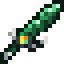 | **Dragonscale Sword** `dragonscale_sword` | Dragonscale (Phase 5) | *Dragon-forged blade — Scorches and weakens foes!* | Serrated emerald-scale fangblade with upturned drake-bone horn crossguard and glowing amber dragon-eye core. |
| 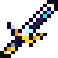 | **Twin-Star Blade** `twin_star_blade` | Twin-Star (Phase 5) | *Twin-Realm Blade — Ignites, weakens, and reveals foes!* | Seraphic platinum-silver & void-indigo greatsword with winged gold/platinum crossguard, cyan twin-star core, and golden halo pommel. |

### Wands & Staves (6 Items)

| Icon (4×) | Item | Mana Cost | Tooltip | Silhouette & Palette Notes |
| :---: | :--- | :---: | :--- | :--- |
| 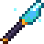 | **Spark Wand** `spark_wand` | 20 Mana | *20 Mana — Zaps foes with chain starlight!* | Nimble faceted cyan-teal crystal spire wand with two floating spark glints and a slate-and-gold shaft. |
|  | **Heart-Bloom Staff** `heart_bloom_staff` | 30 Mana | *30 Mana — Heals and shields friends nearby!* | Rose-pink heart blossom cradled by shaded emerald leaves on a warm wood shaft with gold ferrule. |
|  | **Zephyr Dash Wand** `zephyr_dash_wand` | 25 Mana | *25 Mana — Sky dash with Slow Falling!* | Swept feather-white & lavender sky-wing crest around a glowing mana-violet wind gem. |
| 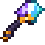 | **Prism Nova Staff** `prism_nova_staff` | 40 Mana | *40 Mana — Radiant starlight shockwave!* | Dual-faceted violet/cyan prism head with a blazing white-hot core and gold astrolabe collar. |
| 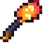 | **Brimstone Meteor Staff** `brimstone_meteor_staff` | 45 Mana | *45 Mana — Calls a safe fiery meteor!* | Volcanic obsidian-and-crimson claw prongs cradling a molten-gold & ember-orange meteor core. |
| 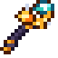 | **Twin-Star Harmony Staff** `twin_star_staff` | 50 Mana | *50 Mana — Heals allies & pets while blasting nearby foes!* | Golden crescent & platinum wing cradle holding two orbiting harmony stars (amber-gold & starlight-cyan). |

---

## Section 2.3 — Tool Sets, Boss Summons, Trophies, Materials & Utility (39)

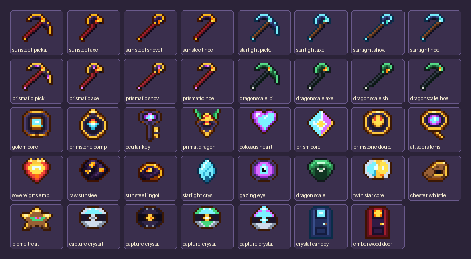

### Tool Sets (16 Items)

#### Sunsteel Tools (Phase 1)

| Icon (4×) | Item | Palette & Design Notes |
| :---: | :--- | :--- |
| 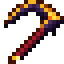 | **Sunsteel Pickaxe** `sunsteel_pickaxe` | Obsidian-purple steel double pick head with hammered-gold bevel, molten solar-ember core, crimson grip, and gold pommel. |
| 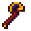 | **Sunsteel Axe** `sunsteel_axe` | Broad solar cleaver blade with hammered-gold rim, glowing ember collar, and crimson-wrapped haft. |
| 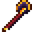 | **Sunsteel Shovel** `sunsteel_shovel` | Obsidian spade with hammered-gold edge, molten ember core, and crimson grip. |
| 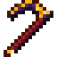 | **Sunsteel Hoe** `sunsteel_hoe` | Swept crescent solar hoe blade with hammered-gold spine and molten ember collar. |

#### Starlight Tools (Phase 1)

| Icon (4×) | Item | Palette & Design Notes |
| :---: | :--- | :--- |
| 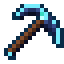 | **Starlight Pickaxe** `starlight_pickaxe` | Midnight-indigo steel socket with glowing starlight-cyan crystal pick tips, warm leather haft, and crystal pommel. |
| 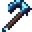 | **Starlight Axe** `starlight_axe` | Crescent starlight-cyan crystal axe head with indigo-steel spine and warm leather grip. |
| 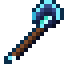 | **Starlight Shovel** `starlight_shovel` | Faceted starlight-cyan crystal spade with glowing teal rune core and leather haft. |
| 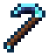 | **Starlight Hoe** `starlight_hoe` | Swept arcane crescent crystal hoe blade with starlight-cyan bevel. |

#### Prismatic Tools (Phase 3)

| Icon (4×) | Item | Palette & Design Notes |
| :---: | :--- | :--- |
| 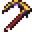 | **Prismatic Pickaxe** `prismatic_pickaxe` | Admiral brass-gold & cutlass-steel pick with prism-violet inlay, magma-orange core, and crimson grip. |
| 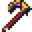 | **Prismatic Axe** `prismatic_axe` | Admiral boarding axe with curved gold-trimmed blade, prism-violet jewel, and magma-orange collar. |
| 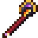 | **Prismatic Shovel** `prismatic_shovel` | Ornate gold-rimmed spade with prism-violet inlay, magma core, and crimson grip. |
| 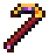 | **Prismatic Hoe** `prismatic_hoe` | Curved admiral-gold hoe with prism-violet jewel and crimson-wrapped haft. |

#### Dragonscale Tools (Phase 5)

| Icon (4×) | Item | Palette & Design Notes |
| :---: | :--- | :--- |
| 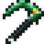 | **Dragonscale Pickaxe** `dragonscale_pickaxe` | Emerald dragonscale pick prongs with drake-bone horn collar, slate-iron haft, and glowing amber dragon-eye core. |
| 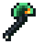 | **Dragonscale Axe** `dragonscale_axe` | Emerald-scale cleaver with drake-bone horn socket, amber eye core, and slate-iron haft. |
| 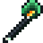 | **Dragonscale Shovel** `dragonscale_shovel` | Leaf-shaped emerald-scale spade with drake-bone collar and amber eye inlay. |
| 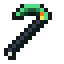 | **Dragonscale Hoe** `dragonscale_hoe` | Curved drake-claw scythe/hoe with emerald edge, bone socket, and amber core. |

### Boss Summons & Keys (4 Items)

| Icon (4×) | Item | Tooltip | Design Notes |
| :---: | :--- | :--- | :--- |
| 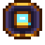 | **Golem Core** `golem_core` | *Training Golem relic* | Heavy carved arcane-slate & brass-gold automaton core with a glowing cyan-and-gold rune slit. |
|  | **Brimstone Compass** `brimstone_compass` | *Use on a Boss Altar to summon Captain Brimstone!* | Ornate admiral brass-gold compass with a crimson-magma & starlight-cyan needle. |
| 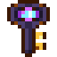 | **Ocular Key** `ocular_key` | *Use on a Boss Altar to summon The Great All-Seer!* | Twilight-slate & gold skeleton key whose bow frames a staring magenta-and-cyan gazing eye. |
| 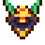 | **Primal Dragon Crest** `primal_dragon_crest` | *Use on a Boss Altar to summon Embercrown Sovereign!* | Winged emerald & gold dragon crest cradling a blazing amber-gold primal flame gem. |

### Boss Trophies (5 Items)

| Icon (4×) | Item | Tooltip | Design Notes |
| :---: | :--- | :--- | :--- |
|  | **Colossus Heart** `colossus_heart` | *Crystal Colossus relic* | Faceted amethyst-violet & starlight-cyan crystalline heart with bright white-cyan inner facets. |
| 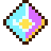 | **Prism Core** `prism_core` | *Boss Trophy — Forges Tier 3 Crystal gear!* | Multi-faceted octahedral prism gem refracting cyan, violet, and gold light. |
|  | **Brimstone Doubloon** `brimstone_doubloon` | *Boss Trophy — Forges Tier 3 Brimstone gear!* | Heavy hammered admiral-gold doubloon stamped with a molten-ember flame crest. |
|  | **All-Seer's Lens** `all_seers_lens` | *Boss Trophy — Relic of The Great All-Seer!* | Gilded twilight-violet monocle framing a radiant cyan-and-magenta cosmic eye. |
| 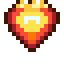 | **Sovereign's Ember Heart** `sovereigns_ember_heart` | *Boss Trophy — Heart of the Embercrown Sovereign!* | Crowned molten-amber & crimson dragon heart pulsing with white-hot solar fire. |

### Materials & Drops (6 Items)

| Icon (4×) | Item | Design Notes |
| :---: | :--- | :--- |
|  | **Raw Sunsteel** `raw_sunsteel` | Chunky obsidian-crimson raw ore cluster veined with bright molten sunsteel gold. |
| 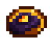 | **Sunsteel Ingot** `sunsteel_ingot` | Beveled obsidian-crimson & hammered-gold ingot with a glowing solar-amber core. |
|  | **Starlight Crystal** `starlight_crystal` | Tall 4-faceted glowing cyan-teal crystal shard with bright white-cyan edge highlights. |
| 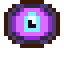 | **Gazing Eye** `gazing_eye` | Floating twilight-magenta & cyan iris orb with a sharp dark slit pupil. |
|  | **Dragon Scale** `dragon_scale` | Shield-shaped emerald dragon scale with drake-bone ridge and bright rim glint. |
|  | **Twin-Star Core** `twin_star_core` | Radiant platinum-and-gold orb uniting a cyan starlight hemisphere and an amber-gold sunsteel hemisphere. |

### Companion, Pet, Utility & Doors (8 Items)

| Icon (4×) | Item | Tooltip | Design Notes |
| :---: | :--- | :--- | :--- |
| 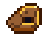 | **Chester Whistle** `chester_whistle` | *Calls Chester* | Playful oak-wood & brass-gold chest-shaped whistle with keyhole emblem. |
| 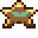 | **Biome Treat** `biome_treat` | *Befriends wild pets & heals tamed pets!* | Golden-baked star-shaped pet biscuit with emerald-leaf & berry-pink sprinkles. |
|  | **Capture Crystal** `capture_crystal` | *Captures Biome Pets — Right-click a wild pet!* | Faceted silver & cyan orb with dark arcane band and empty center clasp. |
|  | **Capture Crystal (Fainted)** `capture_crystal_fainted` | *Resting safely — Hold Biome Treat to wake* | Dimmed arcane-slate crystal orb with a soft resting amber indicator clasp. |
|  | **Capture Crystal (Filled)** `capture_crystal_filled` | *Ready — Holds a tamed pet* | Glowing emerald & cyan crystal orb with a bright golden-white core. |
|  | **Capture Crystal (Summoned)** `capture_crystal_summoned` | *Summoned — Right-click to recall* | Open/active violet & cyan crystal orb radiating an upward summon beam. |
|  | **Crystal Canopy Door** `crystal_canopy_door` | *Crystal Canopy Woods door* | Tall cyan-teal crystal-wood door with glowing starlight window and warm handle. |
|  | **Emberwood Door** `emberwood_door` | *Emberbloom Meadows door* | Deep-crimson emberwood door with warm amber-glowing window and gold handle. |

---

## Section 2.4 — Entities: Companion, Pets, Enemies & Bosses (32)

All 32 entity models pass `python tools/art/lint_art.py --strict`. Items marked **Section 2.4 Upgrade** were rebuilt/upgraded on `art/pass-3-pets`; the remaining 15 models were already strict-lint clean at pass-1 quality.

### Companion (2 Forms)

| Preview | Entity | Sheet | Pass Status | Visual & Silhouette Notes |
| :---: | :--- | :---: | :--- | :--- |
| 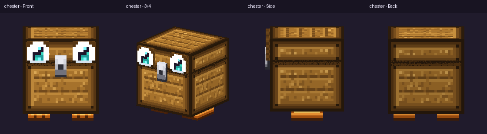 | **Chester** `chester` | `128×128` | Section 2.4 Upgrade | Shaded warm oak planks, iron rim rivets, rounded eyes, and bouncy stubby feet. |
| 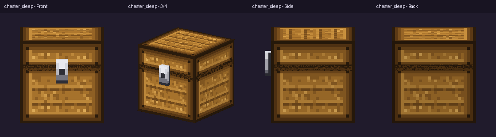 | **Chester (Sleeping)** `chester_sleep` | `128×128` | Section 2.4 Upgrade | Matches vanilla oak chest silhouette when asleep (`ASLEEP` state hides awake-only bones). |

### Overworld Pets — Phase 2 (12 Pets)

| Preview | Pet | Sheet | Pass Status | Visual & Silhouette Notes |
| :---: | :--- | :---: | :--- | :--- |
| 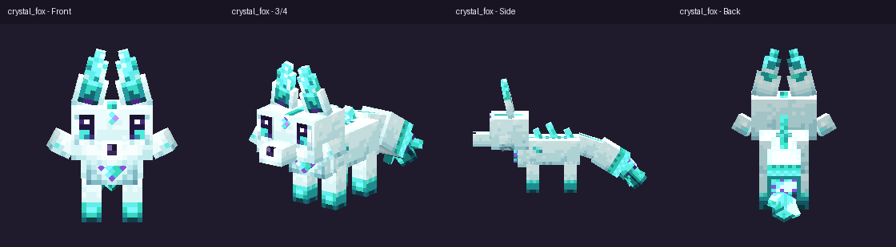 | **Crystal Fox** `crystal_fox` | `256×128` | Section 2.4 Upgrade | Shaded frost-azure fox coat, faceted cyan crystal tail/ear spires, and `_glowmask`. |
| 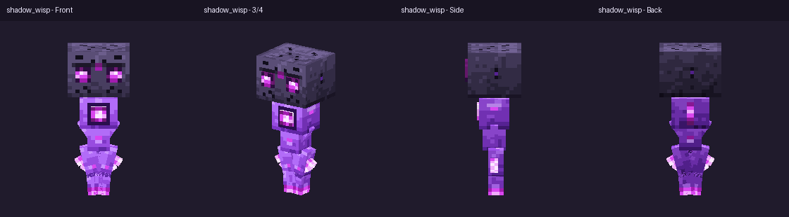 | **Shadow Wisp** `shadow_wisp` | `256×128` | Section 2.4 Upgrade | Faithful to Steve's drawing: shaded void-plum cloak, glowing violet eyes, and wispy tendrils + `_glowmask`. |
| 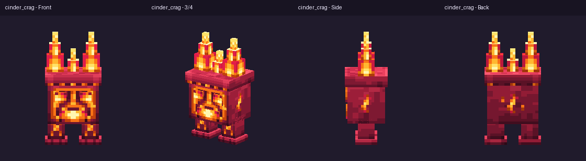 | **Cinder Crag** `cinder_crag` | `256×128` | Section 2.4 Upgrade | Shaded volcanic basalt body, magma-veined crags, crossed-plane cutout fire crown, and `_glowmask`. |
| 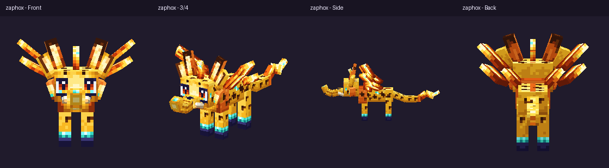 | **Zaphox** `zaphox` | `256×128` | Section 2.4 Upgrade | Shaded spotted cheetah coat, alpha-cutout lightning wings, pointed ears, tapered limbs, and `_glowmask`. |
| 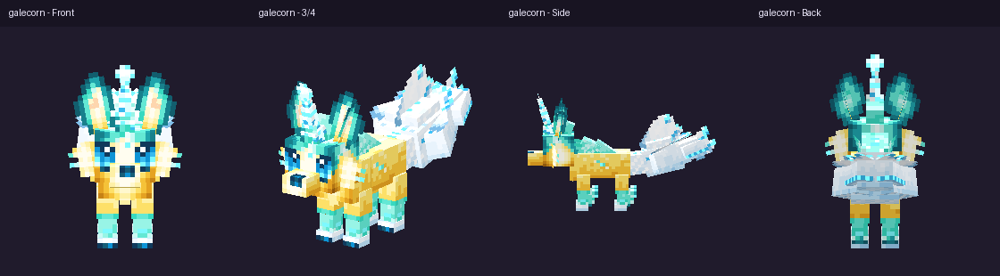 | **Galecorn** `galecorn` | `256×128` | Section 2.4 Upgrade | Shaded sky-fox unicorn coat, spiraling horn, cloud-fan tail, and `_glowmask`. |
| 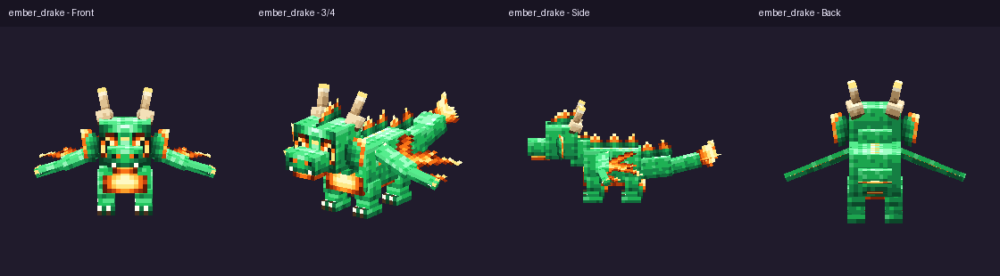 | **Ember Drake** `ember_drake` | `256×128` | Section 2.4 Upgrade | Diamond-scaled emerald coat, scalloped flame-rimmed wings, horned snout, and `_glowmask`. |
| 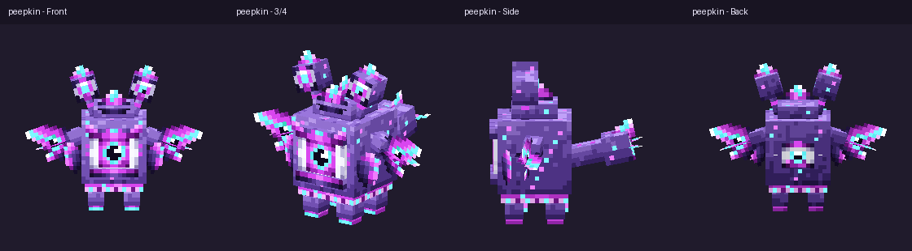 | **Peepkin** `peepkin` | `256×128` | Section 2.4 Upgrade | Starry astral plush orb with crescent markings, eye-spot winglets, and `_glowmask`. |
|  | **Prismling** `prismling` | `256×128` | Section 2.4 Upgrade | Multi-stop beveled Sunsteel armor, faceted rainbow prism core, and two-sided elemental halo. |
|  | **Flurrywing** `flurrywing` | `256×128` | Section 2.4 Upgrade | Frost-shaded snowman body, stick-mitten arms on middle snowball, symmetric veined crystalline wings, and `_glowmask`. |
|  | **Sunbeam** `sunbeam` | `256×256` | Section 2.4 Upgrade | Forged Sunsteel armor, solar helm rune, chest particle beam attack, and `_glowmask`. |
|  | **Frogduck** `frogduck` | `256×128` | Section 2.4 Upgrade | Shaded lagoon-teal frog-duck coat, feathered duck wings, bill, and `_glowmask`. |
|  | **Zapkin** `zapkin` | `256×256` | Section 2.4 Upgrade | Storm-navy armor, sharp Z-kinked cutout lightning head spikes/crown, plasma orb halos, and `_glowmask`. |

### Structure Enemies — Phase 2 (3 Enemies)

| Preview | Enemy | Sheet | Pass Status | Visual & Silhouette Notes |
| :---: | :--- | :---: | :--- | :--- |
|  | **Prism Sentinel** `prism_sentinel` | `256×256` | Section 2.4 Upgrade | Chiseled temple-stone golem with orbiting prism crystals, glowing rune seams, and `_glowmask`. |
|  | **Cinder Raider** `cinder_raider` | `256×256` | Section 2.4 Upgrade | Volcanic-basalt & hammered-bronze pyro-brigand, `entityCutoutNoCull` brazier flame & molten cleaver blades, and `AutoGlowingGeoLayer` `_glowmask`. |
|  | **Astral Stalker** `astral_stalker` | `256×256` | Section 2.4 Upgrade | Hooded twilight-slate & nebula-cloak phantom, 3 constellation eyes, Starlight Compass core, tattered starry cape/crescent halo/Starlight-Katar blades, and `_glowmask`. |

### Bosses (5 Bosses)

| Preview | Boss | Sheet | Pass Status | Visual & Silhouette Notes |
| :---: | :--- | :---: | :--- | :--- |
|  | **Training Golem** `training_golem` | `128×128` | Pass-1 Clean | Arcane-slate & brass practice automaton with glowing cyan core and articulated shield arms. |
|  | **Crystal Colossus** `crystal_colossus` | `256×128` | Section 2.4 Upgrade | Towering amethyst & starlight crystal titan; multi-stop crystal-spire top/bottom shading fix. |
|  | **Captain Brimstone** `captain_brimstone` | `256×128` | Pass-1 Clean | Pirate-admiral ship-rigged juggernaut with mast/Jolly-Roger flag, broadside cannons, and molten magma trim. |
|  | **The Great All-Seer** `great_all_seer` | `256×128` | Pass-1 Clean | Floating cosmic-violet ocular sovereign ringed by orbiting lens shields and cyan/magenta pupil glare. |
|  | **Embercrown Sovereign** `embercrown_sovereign` | `256×128` | Pass-1 Clean | Winged volcanic-emerald & molten-gold dragon king crowned with solar-amber horns. |

### Eye Realm — Phase 4 (4 Entities)

| Preview | Entity | Sheet | Pass Status | Visual & Silhouette Notes |
| :---: | :--- | :---: | :--- | :--- |
|  | **Blinky** `blinky` | `256×128` | Pass-1 Clean | Friendly floating Eye Realm companion orb with expressive lid and twilight-cyan iris. |
|  | **Lens Guardian** `lens_guardian` | `256×128` | Pass-1 Clean | Gilded twilight-slate sentinel framed by rotating ocular lens rings. |
|  | **Oculus Slime** `oculus_slime` | `256×128` | Pass-1 Clean | Translucent cosmic-violet jelly cube enclosing a floating magenta-and-cyan gazing eye. |
|  | **Peeper** `peeper` | `256×128` | Pass-1 Clean | Darting winged eyeball scout with twilight-plum feathers and glowing iris. |

### Dragon Jungle — Phase 5 (6 Entities)

| Preview | Entity | Sheet | Pass Status | Visual & Silhouette Notes |
| :---: | :--- | :---: | :--- | :--- |
|  | **Canopy Dragonling** `canopy_dragonling` | `128×128` | Pass-1 Clean | Compact emerald-leaf hatchling with mossy ridge plates and bright amber eyes. |
|  | **Canopy Wyvern** `canopy_wyvern` | `256×128` | Pass-1 Clean | Broad-winged emerald jungle wyvern with vine-patterned membranes and drake-bone horns. |
|  | **Amber Dragonling** `amber_dragonling` | `128×128` | Pass-1 Clean | Warm amber-gold & terracotta dragon hatchling with glowing solar-orange crest. |
|  | **Amber Wyvern** `amber_wyvern` | `256×128` | Pass-1 Clean | Sun-baked amber & bronze wyvern with swept wingtips and molten-gold markings. |
|  | **Storm Dragonling** `storm_dragonling` | `128×128` | Pass-1 Clean | Storm-indigo & electric-cyan dragon hatchling with crackling crest fins. |
|  | **Storm Glidewing** `storm_glidewing` | `256×128` | Pass-1 Clean | Sleek storm-navy & cyan-veined glider dragon with wide aero-membranes. |
