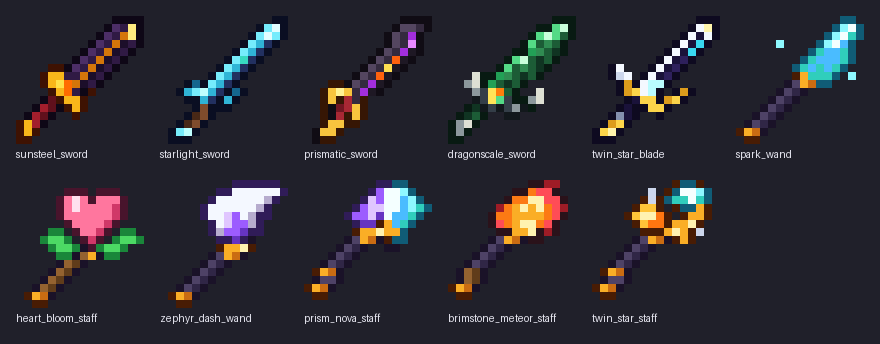
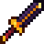
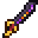
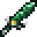
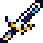
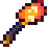
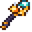

# Art Pass — Section 2.2: Hero Weapons & Staves Gallery

- **Branch:** `art/pass-2-weapons-items`
- **Generator:** [make_hero_weapons_art.py](../tools/art/make_hero_weapons_art.py)
- **Verification:** `check_armor_sheets.py` clean · `lint_art.py --phase5 --strict` clean · `./gradlew build` green

---

## Hero Swords & Blades (5 Items)

Each blade uses its corresponding v3 armor set's exact hue-shifted palette and a bespoke `16×16` silhouette.

| Icon (4×) | Item | Set / Tier | Tooltip | Silhouette & Palette Notes |
| :---: | :--- | :--- | :--- | :--- |
|  | **Sunsteel Sword** `sunsteel_sword` | Sunsteel (Phase 1) | *Sturdy Sunsteel blade* | Broad obsidian-crimson blade with hammered-gold fuller, flared sun-ray crossguard, molten solar core, crimson grip, and gold pommel. |
|  | **Starlight Sword** `starlight_sword` | Starlight (Phase 1) | *Swift Starlight blade* | Sleek midnight-indigo steel with glowing starlight-cyan crystal edge, swept crescent guard, warm leather grip, and teardrop pommel. |
|  | **Prismatic Sword** `prismatic_sword` | Prismatic (Phase 3) | *Boss-forged blade — Lights up and burns foes!* | Pirate-admiral curved cutlass with gold knuckle-bow D-guard, crimson grip, and arcane-violet & magma-orange prism inlay. |
|  | **Dragonscale Sword** `dragonscale_sword` | Dragonscale (Phase 5) | *Dragon-forged blade — Scorches and weakens foes!* | Serrated emerald-scale fangblade with upturned drake-bone horn crossguard and glowing amber dragon-eye core. |
|  | **Twin-Star Blade** `twin_star_blade` | Twin-Star (Phase 5) | *Twin-Realm Blade — Ignites, weakens, and reveals foes!* | Seraphic platinum-silver & void-indigo greatsword with winged gold/platinum crossguard, cyan twin-star core, and golden halo pommel. |

---

## Wands & Staves (6 Items)

| Icon (4×) | Item | Mana Cost | Tooltip | Silhouette & Palette Notes |
| :---: | :--- | :---: | :--- | :--- |
|  | **Spark Wand** `spark_wand` | 20 Mana | *20 Mana — Zaps foes with chain starlight!* | Nimble faceted cyan-teal crystal spire wand with two floating spark glints and a slate-and-gold shaft. |
|  | **Heart-Bloom Staff** `heart_bloom_staff` | 30 Mana | *30 Mana — Heals and shields friends nearby!* | Rose-pink heart blossom cradled by shaded emerald leaves on a warm wood shaft with gold ferrule. |
|  | **Zephyr Dash Wand** `zephyr_dash_wand` | 25 Mana | *25 Mana — Sky dash with Slow Falling!* | Swept feather-white & lavender sky-wing crest around a glowing mana-violet wind gem. |
|  | **Prism Nova Staff** `prism_nova_staff` | 40 Mana | *40 Mana — Radiant starlight shockwave!* | Dual-faceted violet/cyan prism head with a blazing white-hot core and gold astrolabe collar. |
|  | **Brimstone Meteor Staff** `brimstone_meteor_staff` | 45 Mana | *45 Mana — Calls a safe fiery meteor!* | Volcanic obsidian-and-crimson claw prongs cradling a molten-gold & ember-orange meteor core. |
|  | **Twin-Star Harmony Staff** `twin_star_staff` | 50 Mana | *50 Mana — Heals allies & pets while blasting nearby foes!* | Golden crescent & platinum wing cradle holding two orbiting harmony stars (amber-gold & starlight-cyan). |
