# Art Pass — Section 2.3: Tool Sets, Boss Summons, Trophies & Materials Gallery

- **Branch:** `art/pass-2-weapons-items`
- **Generator:** [make_section_2_3_art.py](../tools/art/make_section_2_3_art.py)
- **Verification:** `check_armor_sheets.py` clean · `lint_art.py --phase5 --strict` clean · `./gradlew build` green

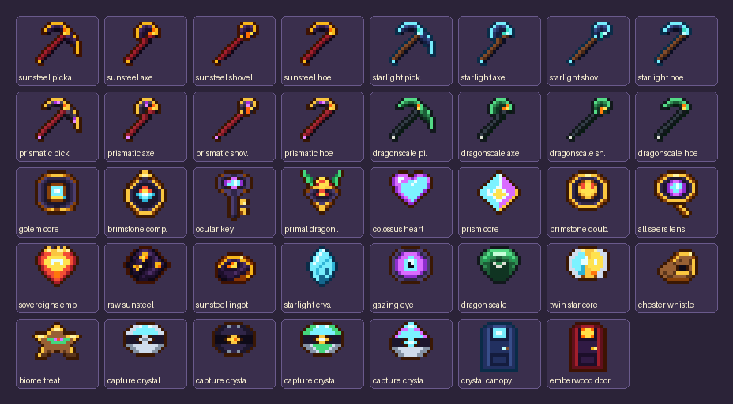

---

## Tool Sets (16 Items)

Each tool set uses its corresponding v3 armor set's exact hue-shifted palette and matches the Section 2.2 hero weapon silhouettes.

### Sunsteel Tools (Phase 1)

| Icon (4×) | Item | Palette & Design Notes |
| :---: | :--- | :--- |
| 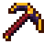 | **Sunsteel Pickaxe** `sunsteel_pickaxe` | Obsidian-purple steel double pick head with hammered-gold bevel, molten solar-ember core, crimson grip, and gold pommel. |
| 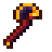 | **Sunsteel Axe** `sunsteel_axe` | Broad solar cleaver blade with hammered-gold rim, glowing ember collar, and crimson-wrapped haft. |
| 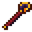 | **Sunsteel Shovel** `sunsteel_shovel` | Obsidian spade with hammered-gold edge, molten ember core, and crimson grip. |
| 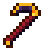 | **Sunsteel Hoe** `sunsteel_hoe` | Swept crescent solar hoe blade with hammered-gold spine and molten ember collar. |

### Starlight Tools (Phase 1)

| Icon (4×) | Item | Palette & Design Notes |
| :---: | :--- | :--- |
| 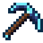 | **Starlight Pickaxe** `starlight_pickaxe` | Midnight-indigo steel socket with glowing starlight-cyan crystal pick tips, warm leather haft, and crystal pommel. |
| 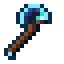 | **Starlight Axe** `starlight_axe` | Crescent starlight-cyan crystal axe head with indigo-steel spine and warm leather grip. |
| 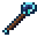 | **Starlight Shovel** `starlight_shovel` | Faceted starlight-cyan crystal spade with glowing teal rune core and leather haft. |
| 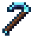 | **Starlight Hoe** `starlight_hoe` | Swept arcane crescent crystal hoe blade with starlight-cyan bevel. |

### Prismatic Tools (Phase 3)

| Icon (4×) | Item | Palette & Design Notes |
| :---: | :--- | :--- |
| 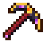 | **Prismatic Pickaxe** `prismatic_pickaxe` | Admiral brass-gold & cutlass-steel pick with prism-violet inlay, magma-orange core, and crimson grip. |
| 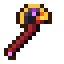 | **Prismatic Axe** `prismatic_axe` | Admiral boarding axe with curved gold-trimmed blade, prism-violet jewel, and magma-orange collar. |
| 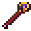 | **Prismatic Shovel** `prismatic_shovel` | Ornate gold-rimmed spade with prism-violet inlay, magma core, and crimson grip. |
| 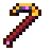 | **Prismatic Hoe** `prismatic_hoe` | Curved admiral-gold hoe with prism-violet jewel and crimson-wrapped haft. |

### Dragonscale Tools (Phase 5)

| Icon (4×) | Item | Palette & Design Notes |
| :---: | :--- | :--- |
| 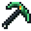 | **Dragonscale Pickaxe** `dragonscale_pickaxe` | Emerald dragonscale pick prongs with drake-bone horn collar, slate-iron haft, and glowing amber dragon-eye core. |
| 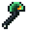 | **Dragonscale Axe** `dragonscale_axe` | Emerald-scale cleaver with drake-bone horn socket, amber eye core, and slate-iron haft. |
| 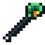 | **Dragonscale Shovel** `dragonscale_shovel` | Leaf-shaped emerald-scale spade with drake-bone collar and amber eye inlay. |
| 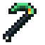 | **Dragonscale Hoe** `dragonscale_hoe` | Curved drake-claw scythe/hoe with emerald edge, bone socket, and amber core. |

---

## Boss Summons & Keys (4 Items)

| Icon (4×) | Item | Tooltip | Design Notes |
| :---: | :--- | :--- | :--- |
| 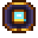 | **Golem Core** `golem_core` | *Training Golem relic* | Heavy carved arcane-slate & brass-gold automaton core with a glowing cyan-and-gold rune slit. |
|  | **Brimstone Compass** `brimstone_compass` | *Use on a Boss Altar to summon Captain Brimstone!* | Ornate admiral brass-gold compass with a crimson-magma & starlight-cyan needle. |
| 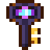 | **Ocular Key** `ocular_key` | *Use on a Boss Altar to summon The Great All-Seer!* | Twilight-slate & gold skeleton key whose bow frames a staring magenta-and-cyan gazing eye. |
| 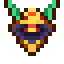 | **Primal Dragon Crest** `primal_dragon_crest` | *Use on a Boss Altar to summon Embercrown Sovereign!* | Winged emerald & gold dragon crest cradling a blazing amber-gold primal flame gem. |

---

## Boss Trophies (5 Items)

| Icon (4×) | Item | Tooltip | Design Notes |
| :---: | :--- | :--- | :--- |
|  | **Colossus Heart** `colossus_heart` | *Crystal Colossus relic* | Faceted amethyst-violet & starlight-cyan crystalline heart with bright white-cyan inner facets. |
| 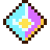 | **Prism Core** `prism_core` | *Boss Trophy — Forges Tier 3 Crystal gear!* | Multi-faceted octahedral prism gem refracting cyan, violet, and gold light. |
|  | **Brimstone Doubloon** `brimstone_doubloon` | *Boss Trophy — Forges Tier 3 Brimstone gear!* | Heavy hammered admiral-gold doubloon stamped with a molten-ember flame crest. |
| 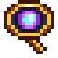 | **All-Seer's Lens** `all_seers_lens` | *Boss Trophy — Relic of The Great All-Seer!* | Gilded twilight-violet monocle framing a radiant cyan-and-magenta cosmic eye. |
| 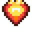 | **Sovereign's Ember Heart** `sovereigns_ember_heart` | *Boss Trophy — Heart of the Embercrown Sovereign!* | Crowned molten-amber & crimson dragon heart pulsing with white-hot solar fire. |

---

## Materials & Drops (6 Items)

| Icon (4×) | Item | Design Notes |
| :---: | :--- | :--- |
|  | **Raw Sunsteel** `raw_sunsteel` | Chunky obsidian-crimson raw ore cluster veined with bright molten sunsteel gold. |
| 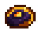 | **Sunsteel Ingot** `sunsteel_ingot` | Beveled obsidian-crimson & hammered-gold ingot with a glowing solar-amber core. |
|  | **Starlight Crystal** `starlight_crystal` | Tall 4-faceted glowing cyan-teal crystal shard with bright white-cyan edge highlights. |
| 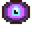 | **Gazing Eye** `gazing_eye` | Floating twilight-magenta & cyan iris orb with a sharp dark slit pupil. |
|  | **Dragon Scale** `dragon_scale` | Shield-shaped emerald dragon scale with drake-bone ridge and bright rim glint. |
|  | **Twin-Star Core** `twin_star_core` | Radiant platinum-and-gold orb uniting a cyan starlight hemisphere and an amber-gold sunsteel hemisphere. |

---

## Companion, Pet, Utility & Doors (8 Items)

| Icon (4×) | Item | Tooltip | Design Notes |
| :---: | :--- | :--- | :--- |
| 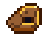 | **Chester Whistle** `chester_whistle` | *Calls Chester* | Playful oak-wood & brass-gold chest-shaped whistle with keyhole emblem. |
| 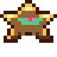 | **Biome Treat** `biome_treat` | *Befriends wild pets & heals tamed pets!* | Golden-baked star-shaped pet biscuit with emerald-leaf & berry-pink sprinkles. |
|  | **Capture Crystal** `capture_crystal` | *Captures Biome Pets — Right-click a wild pet!* | Faceted silver & cyan orb with dark arcane band and empty center clasp. |
|  | **Capture Crystal (Fainted)** `capture_crystal_fainted` | *Resting safely — Hold Biome Treat to wake* | Dimmed arcane-slate crystal orb with a soft resting amber indicator clasp. |
|  | **Capture Crystal (Filled)** `capture_crystal_filled` | *Ready — Holds a tamed pet* | Glowing emerald & cyan crystal orb with a bright golden-white core. |
|  | **Capture Crystal (Summoned)** `capture_crystal_summoned` | *Summoned — Right-click to recall* | Open/active violet & cyan crystal orb radiating an upward summon beam. |
|  | **Crystal Canopy Door** `crystal_canopy_door` | *Crystal Canopy Woods door* | Tall cyan-teal crystal-wood door with glowing starlight window and warm handle. |
|  | **Emberwood Door** `emberwood_door` | *Emberbloom Meadows door* | Deep-crimson emberwood door with warm amber-glowing window and gold handle. |
